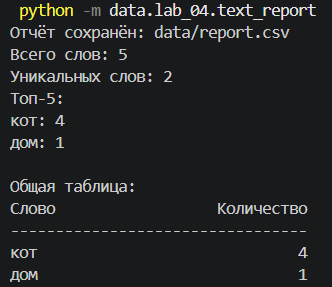
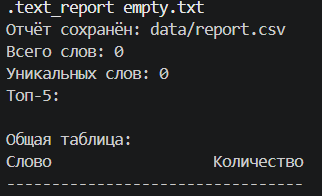
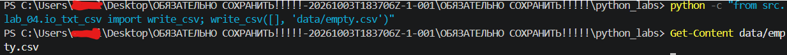
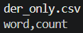
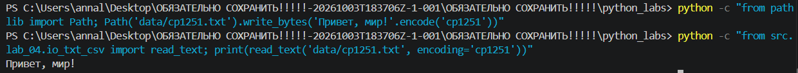
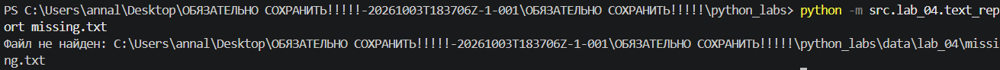
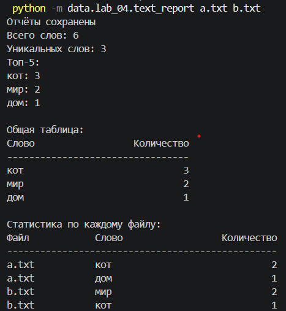

# Лабораторная работа №4

### Овчаренко Анна Сергеевна
### БИВТ-26-6-2
---
Программа обрабатывает один или несколько файлов, выводит статистику в терминал в виде аккуратной таблицы и записывает отчеты.
## Задание A

```
import csv
from pathlib import Path
from typing import Iterable, Sequence


def read_text(path: str | Path, encoding: str = "utf-8") -> str:
    """Читает текст из файла в указанной кодировке."""
    p = Path(path)
    return p.read_text(encoding=encoding)


def write_csv(rows: Iterable[Sequence], path: str | Path,
              header: tuple[str, ...] | None = None) -> None:
    """Записывает строки в CSV. Число столбцов должно быть одинаковым."""
    p = Path(path)
    rows = list(rows)

    if header is not None:
        columns = len(header)
    elif len(rows) > 0:
        columns = len(rows[0])
    else:
        columns = 0

    for r in rows:
        if len(r) != columns:
            raise ValueError("Разное количество столбцов в CSV")

    with p.open("w", newline="", encoding="utf-8") as f:
        w = csv.writer(f)
        if header is not None:
            w.writerow(header)
        for r in rows:
            w.writerow(r)
```
`read_text()` получает путь к файлу и кодировку (по умолчанию UTF-8). Если файла нет или кодировка неверная, Python выдаёт соответствующее исключение.

`write_csv()` сохраняет таблицу с заголовком или без него, используя `newline=""`, чтобы в Windows не появлялись лишние пустые строки.

---
## Задание В.

Сначала вызываются `normalize()` и `tokenize()` из третьей лабораторной, затем `Counter()` считает повторения слов. Сортировка выполняется по убыванию частоты, при равной частоте — по алфавиту.

```

import sys 
from pathlib import Path 
from collections import Counter

from lib.text import normalize, tokenize 
from src.lab_04.io_txt_csv import read_text, write_csv

def frequencies_from_text(text: str) -> dict[str, int]: 
    """Нормализует текст и считает частоты слов.""" 
    tokens = tokenize(normalize(text)) 
    return Counter(tokens)

def sorted_word_counts(freq: dict[str, int]) -> list[tuple[str, int]]: 
    """Сортирует слова по частоте и алфавиту.""" 
    return sorted(freq.items(), key=lambda kv: (-kv[1], kv[0]))

def print_table(rows): 
    """Выводит общую таблицу частот.""" 
    print(f"{'Слово':<20} {'Количество':>12}") 
    print("-" * 33)

    for word, count in rows:
        print(f"{word:<20} {count:>12}")

def main(): 
    data_dir = Path(__file__).resolve().parents[2] / "data"

    files = sys.argv[1:]

    if len(files) == 0:
        files = ["input.txt"]

    files = [data_dir / "lab_04" / filename for filename in files]

    all_freq = {}
    per_file_rows = []
    total_words = 0

    for filename in files:
        try: text = read_text(filename)
        except FileNotFoundError: print("Файл не найден:", filename)
        except UnicodeDecodeError: print("Ошибка кодировки:", filename)

        freq = frequencies_from_text(text)
        total_words += sum(freq.values())

        for word, count in sorted_word_counts(freq):
            per_file_rows.append((filename.name, word, count))
            all_freq[word] = all_freq.get(word, 0) + count

    rows = sorted_word_counts(all_freq)

    if len(files) == 1:
        write_csv(rows, data_dir / "report.csv", ("word", "count"))
        print("Отчёт сохранён: data/report.csv")
    else:
        write_csv(rows, data_dir / "report_total.csv", ("word", "count"))
        write_csv(per_file_rows, data_dir / "report_per_file.csv",
                ("file", "word", "count"))
        print("Отчёты сохранены")

    print("Всего слов:", total_words)
    print("Уникальных слов:", len(all_freq))
    print("Топ-5:")

    for word, count in rows[:5]:
        print(f"{word}: {count}")

    print()
    print("Общая таблица:")
    print_table(rows)

    if len(files) > 1:
        print()
        print("Статистика по каждому файлу:")
        print(f"{'Файл':<15} {'Слово':<20} {'Количество':>12}")
        print("-" * 49)

        for filename, word, count in per_file_rows:
            print(f"{filename:<15} {word:<20} {count:>12}")
if __name__ == "__main__": main()

```
**Исходные файлы**

`io_txt_csv.py` - функции чтения TXT и записи CSV

`text_report.py` - подсчет слов, сортировка и создание отчетов.

`a.txt` - тестовый файл

`b.txt` - тестовый файл

`input.txt` - тестовый файл

`empty.txt` - тестовый файл

**Как запускать???**

Для одного файла (по умолчанию):

```
python -m src.lab_04.text_report
```

Для двух и более файлов:

```
python -m src.lab04.text_report a.txt b.txt
```

При обработке одного файла программа сохраняет data/report.csv. При обработке нескольких файлов она сохраняет data/report_total.csv (общая статистика) и data/report_per_file.csv (статистика по каждому файлу). В терминале выводится общая таблица, если в код добавлен вывод второй таблицы, она также показывается в терминале.

**Вывод**

*Для одного файла*



*Для пустого файла*




При вводе через консоль выводит ничего.

*Для одного заголовка*



*При другой кодировке*



*Если файла не существует или он не найден*



*Для нескольких файлов*


