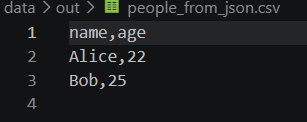
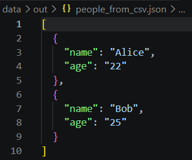
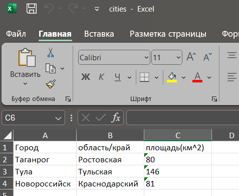

# Лабораторная работа №5

### Овчаренко Анна Сергеевна
### БИВТ-26-6-2
---

## Задание A. JSON -> CSV & CSV-> JSON

```
import json, csv
from pathlib import Path

def json_to_csv(json_path: str, csv_path: str) -> None:
    """
    Преобразует JSON-файл в CSV.
    Поддерживает список словарей [{...}, {...}], заполняет отсутствующие поля пустыми строками.
    Кодировка UTF-8. Порядок колонок — как в первом объекте или алфавитный (указать в README).
    """
    in_data_json = Path(json_path)
    out_data_csv = Path(csv_path)

    if not in_data_json.is_file():
        raise FileNotFoundError(f"Файл не найден: {in_data_json}")

    if in_data_json.suffix.lower() != ".json":
        raise ValueError("Входной файл должен быть формата .json")

    if out_data_csv.suffix.lower() != ".csv":
        raise ValueError("Выходной файл должен быть формата .csv")

    with open(in_data_json, encoding='utf-8') as f:
        try: data = json.load(f)
        except json.JSONDecodeError as e:
            raise ValueError("Пустой файл или неподдерживаемая структура") from e

    if not isinstance(data, list) or len(data) == 0:
        raise ValueError("Пустой файл или неподдерживаемая структура")

    for element in data:
        if not isinstance(element, dict):
            raise ValueError("JSON должен содержать список словарей")

    headers = list(key for row in data for key in row if key not in headers)

    if len(headers) == 0:
        raise ValueError("Пустой файл или неподдерживаемая структура")

    for header in headers:
        if not header.strip():
            raise ValueError("Заголовки не должны быть пустыми")

    with out_data_csv.open("w", newline="", encoding="utf-8") as output:
        writer = csv.writer(output)
        writer.writerow(headers)

    for el in data:
        values = [data.get(header,'') for header in headers]
        writer.writerow(values)


def csv_to_json(csv_path: str, json_path: str) -> None:
    """
    Преобразует CSV в JSON (список словарей).
    Заголовок обязателен, значения сохраняются как строки.
    json.dump(..., ensure_ascii=False, indent=2)
    """
    in_data_csv = Path(csv_path)
    out_data_json = Path(json_path)
    if not in_data_csv.is_file():
        raise FileNotFoundError(f"Файл не найден: {in_data_csv}")

    if in_data_json.suffix.lower() != ".csv":
        raise ValueError("Входной файл должен быть формата .csv")

    if out_data_csv.suffix.lower() != ".json":
        raise ValueError("Выходной файл должен быть формата .json")
    
    with in_data_csv.open("r", newline="", encoding='utf-8') as in_file:
        try:
            reader = csv.DictReader(in_file, strict=True)
            headers = reader.fieldnames
            
            if headers is None or len(headers) == 0:
                raise ValueError("Пустой CSV или отсутствует заголовок")
            for header in headers:
                if not header.strip():
                    raise ValueError("Заголовки не должны быть пустыми")
            if len(headers) != len(set(headers)):
                raise ValueError("Названия столбцов не должны повторяться")
            result = list(reader)

            for el in result:
                if None in el or None in el.values():
                    raise ValueError("Количество полей не совпадает с заголовком")
        except csv.Error as e:
            raise ValueError("Некорректный формат CSV") from e
    with out_data_csv.open("w", encoding='utf-8') as out_file:
        json.dump(result, out_file, ensure_ascii=False, indent=2)
```

**Как запустить JSON-> CSV?**
```python -c "from src.lab_05.json_csv import json_to_csv; json_to_csv('data/samples_05/people.json', 'data/out/people_from_json.csv')"```

*Вывод*



**Как запустить CSV->JSON??**

```python -c "from src.lab_05.json_csv import csv_to_json; csv_to_json('data/samples_05/people.csv', 'data/out/people_from_csv.json')"```

*Вывод*



---
## Задание B. CSV -> XLSX

```python -m pip install -r requirements.txt``` - устанавливает библиотеку openpyxl.
```
from pathlib import Path
import csv

from openpyxl import Workbook
from openpyxl.utils import get_column_letters

def csv_to_xlsx(csv_path: str, xlsx_path: str) -> None:
    """
    Конвертирует CSV в XLSX.
    Использовать openpyxl ИЛИ xlsxwriter.
    Первая строка CSV — заголовок.
    Лист называется "Sheet1".
    Колонки — автоширина по длине текста (не менее 8 символов).
    """
    in_data_csv = Path(csv_path)
    out_data_xlsx = Path(xlsx_path)

    if not in_data_csv.is_file():
        raise FileNotFoundError(f"Файл не найден: {in_data_csv}")

    if in_data_csv.suffix.lower() != ".csv":
        raise ValueError("Входной файл должен быть формата .csv")

    if out_data_xlsx.suffix.lower() != ".xlsx":
        raise ValueError("Выходной файл должен быть формата .xlsx")
    
    try:
        with in_data_csv.open('r', encoding='utf-8',newline='') as f:
            reader = csv.reader(f, strict=True)
            headers = next(reader, None)

            if not headers:
                raise ValueError("CSV пустой или не содержит заголовков")
            for header in headers:
                if not header.strip():
                    raise ValueError("Заголовки не должны быть пустыми")
            if len(set(headers)) != len(headers):
                raise ValueError("Заголовки не должны повторяться")
            
            data = [headers]

            for record in reader:
                if len(record) == 0:
                    continue
                if len(record) != len(headers):
                    raise ValueError("Количество полей не совпадает с заголовком")
                data.append(record)
    except csv.Error as e:
        raise ValueError("Ошибка в структуре CSV") as e
    
    excel = Workbook()
    worksheet = excel.active
    worksheet.title = 'Sheet1'
    widths = [0] * len(headers)
    
    for record in data:
        worksheet.append(record)
        for index, text in enumerate(record):
            cell = worksheet.cell(row=worksheet.max_row, column=index + 1)
            cell.data_type='s'

            length = max((len(line) for line in text.splitlines()), default = 0)
            if length > widths[index]:
                widths[index]=length
        
        for index, width in enumerate(widths, start=1):
            letter = get_column_letters(index)
            worksheet.column_dimensions[letter].width = min(255, msx(8, width+2))
        try:
            excel.save(out_data_xlsx)
        finally:
            excel.close()

```
Создаёт Excel-файл cities.xlsx из cities.csv.

**Как запустить??**
```python -c "from src.lab_05.csv_xlsx import csv_to_xlsx; csv_to_xlsx('data/samples_05/cities.csv', 'data/out/cities.xlsx')"```

*Вывод*


