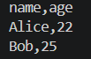
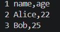
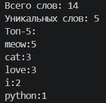
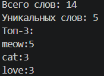

# Лабораторная работа №6

### Овчаренко Анна Сергеевна
### БИВТ-26-6-2
---

## CLI_TEXT
### cat
Функция принимает на вход путь к файлу и выводит каждую его строку с нумерацией или без в зависимости от того, укажет ли пользователь соответствующий аргумент или нет(-n). Команда проверяет наличие файла, кодировку utf-8 (обязательно!).
```
def cat_command(input_path:str, numbers: bool = False) -> None:
    path = Path(input_path)

    if not path.is_file():
        raise FileNotFoundError("Файл не найден")
    
    with open(path, "r", encoding='utf-8') as f:
        for num, line in enumerate(f, start = 1):
            if numbers:
                print(f"{num} {line}", end="")
            else:
                print(f"{line}", end="")
```

### stats
Команда приниимает на вход путь к файлу, который кодирован utf-8, проверяет его наличие и обрабатывает слова. С помощью функций из ЛР3 создает статистику и выводит ее в виде таблицы. В зависимости от переданного аргумента в top, будет выводиться топ из стольки слов.
```
def stats_command(input_path: str, top: int = 5) -> None:
    path = Path(input_path)

    if not path.is_file():
        raise FileNotFoundError("Файл не найден")

    text = read_text(input_path)
    
    tokens = tokenize(normalize(text))
    freq = count_freq(tokens)

    total_words = len(tokens)
    unique_words = len(freq)
    top_words = top_n(freq, top)

    print(f'Всего слов: {total_words}')
    print(f'Уникальных слов: {unique_words}')
    print(f'Топ-{top}:')
    for w, c in top_words:
        print(f"{w}:{c}")
```

### main()
Основная функция создает ArgumentParser, добавляет подкоманды cat и stats с помощью add_subparsers и уже в низ с помощью add_arguement описывает подаваемые аргументы. Выбор выполняемой операции определяется по значению args.command.
```
def main():
    parser = argparse.ArgumentParser(description = "CLI-утилиты")
    subparsers = parser.add_subparsers(dest = "command", required=True)

    cat_parser = subparsers.add_parser("cat", help = "Выводит содержание файла")
    cat_parser.add_argument("--input", required= True, help = "Считывает путь к входному файлу")
    cat_parser.add_argument("-n", action = "store_true", help = "Выводит номера строк файла")

    stats_parser = subparsers.add_parser("stats", help = "Частоты слов")
    stats_parser.add_argument("--input", required = True, help = "Считывает путь к входному файлу")
    stats_parser.add_argument("--top", type = int, default = 5, help = "Топ скольки слов нужно вывести")

    args = parser.parse_args()

    if args.command == "stats" and args.top < 1:
        parser.error("--top должен быть больше 0")
    try:
        if args.command == "cat":
            cat_command(args.input, args.n)

        elif args.command == "stats":
            stats_command(args.input, args.top)
    except FileNotFoundError:
        parser.error(f"Файл не найден: {args.input}")
    except UnicodeDecodeError:
        parser.error(f"Файл {args.input} написан в кодировке, отличной от UTF-8")

if __name__ == "__main__":
    main()
```
### Запуск

**Запуск cat без нумерации**

``python -m src.lab_06.cli_text cat --input data/samples_05/people.csv``



**Запуск cat с нумерацией**

``python -m src.lab_06.cli_text cat --input data/samples_05/people.csv -n``



**Запуск stats без указания слов в топе**

``python -m src.lab06.cli_text stats --input data/samples/people.txt``



**Запуск stats с указанием слов в топе**

``python -m src.lab_06.cli_text stats --input data/samples/people.txt --top 3``



### Обработка ошибок
* FileNotFoundError — входной файл не существует.
* UnicodeDecodeError — невозможно декодировать содержимое файла с использованием UTF-8.
* parser.error() — аргумент --top имеет недопустимое значение или пользователь неправильно указал параметры команды.

### Проверка справки --help

## CLI_CONVERT
```
import argparse

from pathlib import Path

from src.lab_05.json_csv import json_to_csv, csv_to_json
from src.lab_05.csv_xlsx import csv_to_xlsx

def main():
    parser = argparse.ArgumentParser(description="Конвертеры данных между JSON, CSV и XLSX")
    subparsers = parser.add_subparsers(dest = "command", required=True)

    json2csv_parser = subparsers.add_parser("json2csv", help = "JSON -> CSV")
    json2csv_parser.add_argument("--in", dest = "input", required = True, help = "Входной файл JSON")
    json2csv_parser.add_argument("--out", dest = "output", required = True, help = "Выходной файл CSV")

    csv2json_parser = subparsers.add_parser("csv2json", help = "CSV -> JSON")
    csv2json_parser.add_argument("--in", dest = "input", required = True, help = "Входной файл CSV")
    csv2json_parser.add_argument("--out", dest = "output", required = True, help = "Выходной файл JSON")

    csv2xlsx_parser = subparsers.add_parser("csv2xlsx", help = "CSV -> XLSX")
    csv2xlsx_parser.add_argument("--in", dest = "input", required = True, help = "Входной файл CSV")
    csv2xlsx_parser.add_argument("--out", dest = "output", required = True, help = "Выходной файл XLSX")

    args = parser.parse_args()

    try:
        if args.command == "json2csv":
            json_to_csv(Path(args.input), Path(args.output))
        
        elif args.command == "csv2json":
            csv_to_json(Path(args.input), Path(args.output))
        
        elif args.command == "csv2xlsx":
            csv_to_xlsx(Path(args.input), Path(args.output))
    except FileNotFoundError:
        parser.error(f"Файл не найден: {args.input}")
    except UnicodeDecodeError:
        parser.error(f"Файл {args.input} написан в кодировке, отличной от UTF-8")
    except ValueError as error:
        parser.error(str(error))

if __name__ == "__main__":
    main()
```

### Обработка ошибок

### Проверка справки --help
