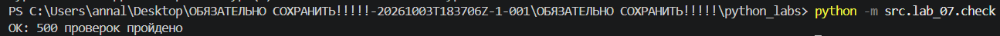
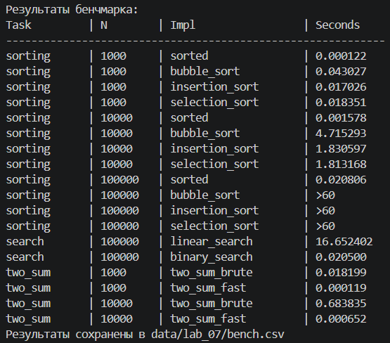

# Лабораторная работа №7

### Овчаренко Анна Сергеевна
### БИВТ-26-6-2
---

## Задание A. Поиск (search.py)

### linear_search

Последовательно перебирает элементы списка и сравнивает их с искомым числом. Возвращает индекс первого вхождения или -1, если число не найдено. 

*Сложность: O(n)*

```
def linear_search(nums, x) -> int:
    """Возвращает индекс первого вхождения x или -1."""
    for i in range(len(nums)):
        if x == nums[i]:
            return i
    return -1
```
### binary_search

Ищет число в отсортированном списке, каждый раз уменьшая область поиска вдвое. Возвращает индекс найденного элемента или -1. 

*Сложность: O(log n)*

```
def binary_search(sorted_nums, x) -> int:
    """Ищет x  в отсортированном списке.
    Для неотсортированного списка результат не определен."""
    lo = 0
    hi = len(sorted_nums) - 1
    while lo <= hi:
        mid = (lo+hi) // 2

        if sorted_nums[mid] == x:
            return mid
        elif sorted_nums[mid]< x:
            lo = mid + 1
        else:
            hi = mid - 1
    return -1
```

### two_sum_brute

С помощью двух вложенных циклов перебирает пары чисел и ищет пару с заданной суммой. Возвращает индексы в кортеже или None. 

*Сложность: O(n^2)*

```
def two_sum_brute(nums, target) -> tuple[int, int] | None:
    """Ищет пару индексов таких чисел, сумма которых равна target."""
    for i in range(len(nums)):
        for j in range(i + 1, len(nums)):
            if (nums[i] + nums[j]) == target:
                return (i, j)
    return None
```

### two_sum_fast

Ищет пару чисел с нужной суммой за один проход. Использует словарь для хранения просмотренных чисел и их индексов.

*Сложность: O(n)*

```
def two_sum_fast(nums, target) -> tuple[int, int] | None:
    """То же, что two_sum_brute, но за один проход со словарём."""
    seen = {}
    for i in range(len(nums)):
        needed = target - nums[i]
        if needed in seen:
            return (seen[needed], i)
        seen[nums[i]] = i
    return None
```

---
## Задание B. Сортировки (sorting.py)

### bubble_sort

Сравнивает соседние элементы и меняет их местамиБ если они стоят в неправильном порядке. Повторяет проходы до завершения сортировки.

*Сложность: O(n^2) в худшем случае, O(n) для уже отсортированного списка с ранним выходом*

```
def bubble_sort(nums) -> list:
    """Новый список, отсортированный по возрастанию. Исходный не меняется.
    """
    nums = list(nums)
    n = len(nums)

    for i in range(n):
        swapped = False
        for j in range(n-1-i):
            if nums[j] > nums[j+1]:
                nums[j], nums[j+1] = nums[j+1], nums[j]
                swapped = True
        if not swapped:
            break
    return nums
```
### insertion_sort

Последовательно берет элементы списка и вставляет каждый на нужное место среди уже отсортированных элементов.

*Сложность: O(n^2), O(n) для уже отсортированного*
```
def insertion_sort(nums) -> list:
    """Тот же контракт, что у bubble_sort."""
    nums = list(nums)

    for i in range(1, len(nums)):
        current = nums[i]
        j = i - 1
        while j >= 0 and nums[j] > current:
            nums[j+1] = nums[j]
            j -= 1
        nums[j+1] = current
    return nums
```

### selection_sort

На каждом проходе находит минимальный элемент в неотсортированной части списка и меняет его местами с текущим.

*Сложность: O(n^2), так как поиск минимального элемента повторяется для каждой позиции*

```
def selection_sort(nums) -> list:
    """Тот же контракт, что у bubble_sort."""
    nums = list(nums)
    n = len(nums)

    for i in range(n):
        min_index = i
        for j in range(i+1, n):
            if nums[j] < nums[min_index]:
                min_index = j
        nums[i], nums[min_index] = nums[min_index], nums[i] 
    return nums
```
---
## Задание C. Проверка против эталона (check.py)

### Импортируемые функции и библиотеки

* random - библиотека, чтобы генерировать случайные числа. Используется в создании рандомных списков и чисел для проверки.
* src.lab_07.sorting (...) - функции сортировок.
* src.lab_07.search (...) - функции поиска.

```
import random
from src.lab_07.sorting import bubble_sort, insertion_sort, selection_sort
from src.lab_07.search import (
    linear_search,
    binary_search,
    two_sum_brute,
    two_sum_fast
)
```

### check_sorting

Проверяет сортировки на случайных списках, сравнивает результат с sorted() и проверяет сохранность исходного списка. При расхождении поднимается AssertionError с данными, на которых оно случилось.

```
def check_sorting(fn, trials=100) -> None:
    """Проверяет сортировку на случайных списках"""
    for _ in range(trials):
        n = random.randint(0, 50)
        nums = [random.randint(-100, 100) for _ in range(n)]
        original = list(nums)
        result = fn(nums)
        assert result == sorted(nums), f"{fn.__name__} ошиблась на {nums}: {result}"
        assert nums == original, f"{fn.__name__} изменила исходный список"
    return trials
```

### check_search

Проверяет линейный и бинарный поиск на случайных списках, сравнивая результаты с ожидаемыми. При расхождении поднимается AssertionError с данными, на которых оно случилось.

```
def check_search() -> None:
    for _ in range(100):
        n = random.randint(0, 50)
        nums = [random.randint(-100,100) for _ in range(n)]
        sorted_nums = sorted(nums)
        original = list(nums)
        
        targets = [101]
        if nums:
            targets.append(nums[0])
            targets.append(nums[-1])
            targets.append(random.choice(nums))
        
        for x in targets:
            try:
                expected = nums.index(x)
            except ValueError:
                expected = -1
            
            result = linear_search(nums, x)
            assert result == expected, f"Ошибка линейного поиска: {nums}, {x}"

            result = binary_search(sorted_nums, x)
            if x in sorted_nums:
                assert 0 <= result <= len(sorted_nums)
                assert sorted_nums[result] == x
            else:
                assert result == -1
    return 100
```

### check_two_sum

Проверяет оба алгоритма поиска пары чисел и правильность полученных результатов. При расхождении поднимается AssertionError с данными, на которых оно случилось.

```
def check_two_sum(trials=100) -> None:
    for _ in range(trials):
        n = random.randint(2,30)
        nums = [random.randint(-50,50) for _ in range(n)]

        target = random.randint(-200, 200)
        expected = []
        for i in range(len(nums)):
            for j in range(i + 1, len(nums)):
                if (nums[i] + nums[j]) == target:
                    expected.append((i, j))

        result_brute = two_sum_brute(nums, target)
        result_fast = two_sum_fast(nums, target)
        if expected:
            assert result_brute in expected, f"Поиск индексов двумя циклами элементов, образующих сумму не выполнен верно: {nums}, {target}"
            assert result_fast in expected, f"Поиск индексов словарем элементов, образующих сумму не выполнен верно: {nums}, {target}"
        else:
            assert result_brute  is None
            assert result_fast is None
    return trials
```

### main

Релизован подсчет общего числа проверок + выводится подтверждение, что все n проверок пройдены.

```
if __name__ == "__main__":
    random.seed(42)
    total = 0
    for fn in (bubble_sort, insertion_sort, selection_sort):
        total += check_sorting(fn)
    total += check_search()
    total += check_two_sum()
    print(f"OK: {total} проверок пройдено")
```
*Как запустить?*

```python -m src.lab_07.check```

*Что выводит?*



---
## Задание D. Бенчмарк (bench.py)

### Импортируемые функции и библиотеки

* CSV - необходимая библиотека для оформления вывода бенчмарка. 
* write_csv - функция, чтобы оформить данные в csv файл.
* timeit - библиотека, чтобы замерить время выполнения сортировок и поиска.
* random - библиотека, чтобы генерировать случайные числа. Используется в создании рандомных списков и чисел для проверки.
* src.lab_07.sorting (...) - функции сортировок.
* src.lab_07.search (...) - функции поиска элемента.

```
import csv
from src.lab_04.io_txt_csv import write_csv

import timeit
import random

from src.lab_07.sorting import (
    bubble_sort,
    insertion_sort,
    selection_sort
)

from src.lab_07.search import (
    linear_search,
    binary_search,
    two_sum_brute,
    two_sum_fast
)
```

### bench_sorts

Создает случайные списки разных размеров и измеряет время сортировок с помощью timeit. Результат сохраняется в списке с кортежами данных.

```
def bench_sorts() -> list[tuple[str, int, str, str]]:
    """Запускает бенчмарки для сортировок и собирает данные в список с кортежами"""

    random.seed(42)
    rows = []
    sizes = [1_000, 10_000, 100_000]
    for n in sizes:
        data = [random.randint(-1_000_000, 1_000_000) for _ in range(n)]
        time_s = timeit.timeit(lambda: sorted(data), number = 1)

        rows.append(("sorting", n, "sorted", f"{time_s:.6f}"))
        funcs = [("bubble_sort", bubble_sort), ("insertion_sort", insertion_sort), ("selection_sort", selection_sort)]

        for name, fc in funcs:
            if n <= 10_000:
                time = timeit.timeit(lambda: fc(data), number = 1)
                rows.append(("sorting", n, name, f"{time:.6f}"))
            else:
                rows.append(("sorting", n, name, ">60"))
    return rows
```

### bench_search

Измеряет время линейного, бинарного поиска и двух вариантов two_sum с помощью timeit. Полученные данные записываются в кортежи, а потом объединяются в список.

```
def bench_search() -> list[tuple[str, int, str, str]]:
    """Запускает бенчмарки для поиска и собирает данные в список с кортежами"""

    random.seed(42)
    rows = []
    data = [random.randint(-1_000_000, 1_000_000) for _ in range (100_000)]
    targets = [random.choice(data) for _ in range(10000)]

    time_ls = timeit.timeit(lambda: [linear_search(data, t) for t in targets], number = 1)
    rows.append(("search", 100_000, "linear_search", f"{time_ls:.6f}"))

    sorted_data = sorted(data)
    time_bs = timeit.timeit(lambda: [binary_search(sorted_data, t) for t in targets], number = 1)
    rows.append(("search", 100_000, "binary_search", f"{time_bs:.6f}"))

    for n in [1_000, 10_000]:
        data_ts = [random.randint(-1_000_000, 1_000_000) for _ in range (n)]
        a, b = random.sample(data_ts, 2)
        targ = a + b

        t_tsb = timeit.timeit(lambda: two_sum_brute(data_ts, targ), number = 1)
        rows.append(("two_sum", n, "two_sum_brute", f"{t_tsb:.6f}"))

        t_tsf = timeit.timeit(lambda: two_sum_fast(data_ts, targ), number = 1)
        rows.append(("two_sum", n, "two_sum_fast", f"{t_tsf:.6f}"))
    
    return rows
```

### main

Объединяет все полученные данные из предыдущих функций в общий csv файл и выводит эти же данные в виде таблицы в терминал. 

```
def main():
    """Собирает все полученные списки из ранее реализованых функций в CSV и выводит сводную таблицу в консоль"""
    header = ("task", "n", "impl", "seconds")
    rows = []
    rows.extend(bench_sorts())
    rows.extend(bench_search())

    write_csv(rows, "data/lab_07/bench.csv", header)

    print("Результаты бенчмарка:")
    print(f"{'Task':<12} | {'N':<8} | {'Impl':<20} | {'Seconds':<12}")
    print('-' * 60)
    for t, n, i, s in rows:
        print(f"{t:<12} | {n:<8} | {i:<20} | {s:<12}")
    
    print("Результаты сохранены в data/lab_07/bench.csv")

if __name__ == "__main__":
    main()
```

*Как запустить?*

```python -m src.lab_07.bench```

*Что выводит?*

* *В терминал*



* *В bench.csv*

```
task,n,impl,seconds
sorting,1000,sorted,0.000125
sorting,1000,bubble_sort,0.043540
sorting,1000,insertion_sort,0.017375
sorting,1000,selection_sort,0.018232
sorting,10000,sorted,0.001552
sorting,10000,bubble_sort,4.665590
sorting,10000,insertion_sort,1.816772
sorting,10000,selection_sort,1.794847
sorting,100000,sorted,0.020902
sorting,100000,bubble_sort,>60
sorting,100000,insertion_sort,>60
sorting,100000,selection_sort,>60
search,100000,linear_search,16.582380
search,100000,binary_search,0.020733
two_sum,1000,two_sum_brute,0.018056
two_sum,1000,two_sum_fast,0.000117
two_sum,10000,two_sum_brute,0.678485
two_sum,10000,two_sum_fast,0.000767
```

---
## Выводы

1. Пузырек VS sorted()

При увеличении размера списка в 10 раз время работы пузырьковой сортировки увеличится примерно в 100 раз, так как ее сложность - O(n^2). Это связано с большим количеством сравнений и перестановок элементов. Встроенная функция sorted() работает значительно быстрее, поскольку использует более эффективный алгоритм со сложностью O(n log n). Поэтому при увеличении размера списка в 10 раз время ее работы возрастает примерно в 12 раз, а не в 100.

2. Бинарный поиск: когда бесполезен, когда окупается?

Бинарный поиск работает быстрее линейного, так как на каждом шаге уменьшает область поиска вдвое. Однако для его работы список должен быть отсортирован. Если нужно найти всего несколько элементов, затраты времени на сортировку могут оказаться больше, чем на сам поиск. Но если поиск выполняется много раз по одному списку, предварительная сортировка окупается, поскольку каждый последующий поиск выполняется значительно быстрее предыдущего.

3. check.py: как отработал?

С помощью проверок смогла обнаружить некоторые проблемы в самих функциях (скринов не осталось, но к примеру: имя переменной было неверным, из-за чего поиск элемента не работал, значение переменной не обновлялось. AssertionError остановила проверку, указала на несоответствие, вывела в терминал список и элемент, индекс которого ищем, что позволило перепроверить работу программы.) и исправить. Больше расхождений помимо таких глупостей не было найдено. Всего было проведено 500 проверок. 


